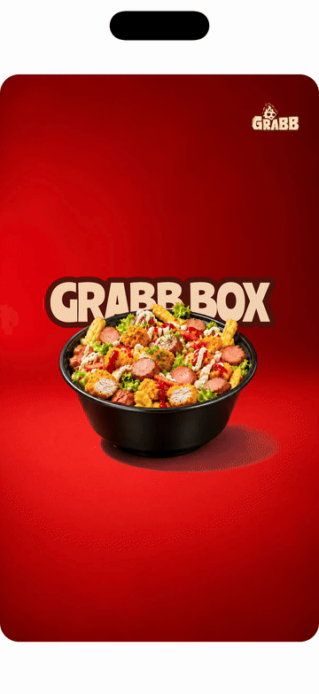

# Grabb Reel Animation 🎬

A Flutter application showcasing an animated product reel designed specifically for **Facebook Reels** and vertical short-form content (9:16 Aspect Ratio).

---

## 📽️ Demo Preview

<div align="center">
  
</div>

*Screen recording demonstrating the product slide sequence, dynamic tilt, synchronized title fade animation, and 9:16 vertical reel framing.*

---

## ✨ Features

- **📱 Facebook Reels 9:16 Framing**: Framed inside a 9:16 aspect ratio container with 24px rounded anti-aliased corners for accurate short-form video previews.
- **🔄 Synchronized Product Cycling**: Loops through a sequence of Grabb product items:
  1. **Golden Nugget Box**
  2. **Grabb Box**
  3. **Sausage Overload Box**
- **🎞️ Smooth Timeline Slide & Tilt**:
  - **Slide In**: Product slides in from the right (`Curves.easeOutCubic`) with a subtle physical motion tilt.
  - **Center Pause**: Holds steadily in the center for previewing.
  - **Slide Out**: Accelerates smoothly off-screen to the left (`Curves.easeInCubic`).
- **✨ Synchronized Text Fade Animation**: Dual-stroke product titles fade in as the item enters and fade out as the item exits.
- **🎨 Custom Dual-Stroke Typography**:
  - Powered by `GoogleFonts.ranchers`.
  - Layered dark brown stroke border (`#4a160c`) with a cream fill (`#fbdeba`).
- **⚡ Hot Reload Safe**: Implements `reassemble()` lifecycle handlers to prevent state initialization errors during Flutter Hot Reloads.

---

## 🛠️ Project Structure

```
grabb_animation/
├── assets/
│   ├── Background v2.png             # Background image
│   ├── Golden Nugget Box v4.png      # Product image 1
│   ├── Grabb Box v4.png              # Product image 2
│   ├── Sausage Overload Box v4.png   # Product image 3
│   └── GRABB_logo.png                # Top-right brand logo
├── lib/
│   └── main.dart                     # Animation controllers and UI layout
├── grabb_reel_animation.gif          # Animated demo preview for GitHub README
├── grabb_reel_animation.mp4          # App screen recording video source
├── pubspec.yaml                      # Project dependencies & assets configuration
└── README.md
```

---

## 🚀 Getting Started

### Prerequisites

Make sure you have Flutter installed on your machine.

- [Flutter SDK Installation Guide](https://docs.flutter.dev/get-started/install)

### Installation & Run

1. **Clone the repository / open project directory**:
   ```bash
   cd grabb_animation
   ```

2. **Install dependencies**:
   ```bash
   flutter pub get
   ```

3. **Run the app**:
   ```bash
   flutter run
   ```

---

## 📄 License

This project is created for product showcase animation demonstrations.
